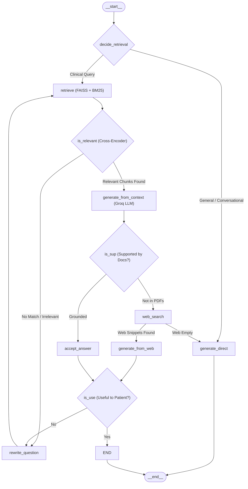

# HealthAssist / ArogyaAI 🏥
**Next-Generation Clinical Decision Support, Self-RAG, Multimodal Diagnostics & Healthcare Assistant**

[](https://github.com/princeVerma73/SAI)
[](https://vitejs.dev/)
[-green)](https://nodejs.org/)
[-009688?logo=fastapi)](https://fastapi.tiangolo.com/)
[](https://github.com/facebookresearch/faiss)
[](https://groq.com/)

A modern, clinical-grade digital health companion designed for patients and healthcare providers. Features a clean 5-view sidebar interface with evidence-grounded **Self-RAG**, multimodal **visual triage for cuts & skin conditions**, end-to-end **lab report biomarker extraction with an interactive AI chat assistant**, an evidence-based **chronic disease risk engine**, and **bilingual voice interaction**.

---

## 📑 Table of Contents
1. [Key Features & Capabilities](#-key-features--capabilities)
2. [Self-RAG Architecture & Workflow](#-self-rag-architecture--workflow)
3. [System Architecture](#-system-architecture)
4. [Tech Stack](#-tech-stack)
5. [Prerequisites & Environment Setup](#-prerequisites--environment-setup)
6. [How to Run (3 Easy Commands)](#-how-to-run-step-by-step)
7. [Tabs & User Flow Guide](#-tabs--user-flow-guide)
8. [API Endpoints Reference](#-api-endpoints-reference)
9. [Clinical Safety & Disclaimer](#-clinical-safety--disclaimer)

---

## 🌟 Key Features & Capabilities

### 1. 🔍 Ask — Self-RAG Clinical Chatbot & Visual Triage
* **Hybrid Dense + Lexical Search**: Combines **FAISS IndexFlatIP** vector embeddings (4096-dim) with **BM25Okapi** keyword scoring on indexed Indian Council of Medical Research (ICMR) cardiology guidelines, DCMC specialty manuals, and National List of Essential Medicines (NLEM).
* **Cross-Encoder Semantic Reranker**: Reranks top candidates to select the top-3 most medically relevant chunks with zero hallucination.
* **Autonomous Self-RAG State Machine**: Full execution trace shown in the UI (`__start__ → decide_retrieval → retrieve → is_relevant → generate_from_context → is_sup → web_search → generate_direct → is_use → END → __end__`).
* **Web Search Fallback**: When indexed clinical guidelines lack specific answers (e.g. anemia signs, fever protocols), the pipeline autonomously routes through real-time web retrieval / AI general medical knowledge and flags the source badge (`🌐 Web Search` / `💡 AI Knowledge`).
* **👁️ Visual Triage for Cuts, Rashes & Wounds**:
  * Upload photos of skin conditions, cuts, kitchen burns, insect bites, or rashes directly in the chat.
  * Powered by **Gemini Clinical Vision** (`gemini-flash-lite-latest`) to inspect depth, erythema, swelling, and wound edges.
  * Provides immediate first aid steps, infection warning signs, and emergency triage red flags.
  * Supports **continuous multi-turn conversational follow-ups** without re-uploading the image.

### 2. 📊 Reports — Multimodal Lab Analyzer & Interactive Report Assistant
* **Complete Biomarker Extraction**: Extracts 10–20+ individual laboratory tests from scanned images or PDF documents (e.g. CBC, Lipid Profile, LFT, KFT, Thyroid).
  * Tested live on real lab reports: extracts HB, Total RBC, HCT, MCV, MCH, MCHC, Platelets, WBC, Neutrophils, Lymphocytes, Eosinophils, Monocytes, ESR, TSH with exact values, reference intervals, and status flags (`Normal`, `Low`, `High`, `Critical`).
* **💾 Local RAM Report History**:
  * Saves all uploaded reports in local memory/session RAM.
  * Top navigation pills allow patients and physicians to seamlessly switch between different reports without re-uploading.
* **💬 Dedicated Right-Side AI Report Assistant**:
  * Context-grounded chat assistant directly beside the lab report table.
  * Ask specific questions: *"Why are my monocytes elevated at 12%?"*, *"Is my low WBC dangerous?"*, *"Give me a tailored diet plan for these findings."*
  * Quick starter chips for common inquiries (*Abnormal values*, *Diet plan*, *See a doctor?*).

### 3. 🫀 Risk and Plan — Chronic Disease Risk Engine
* **Multifactorial Clinical Risk Scoring**:
  * Evaluates **Type 2 Diabetes** risk using the Finnish Diabetes Risk Score (FINDRISC) model.
  * Calculates 10-year **Cardiovascular Disease** risk using adapted Framingham Heart Study algorithms.
  * Evaluates **Hypertension** risk based on age-related vascular stiffness and weight metrics.
* **Fully Dynamic Calculation**: Adjusts immediately when modifying Age, Weight (BMI), Sleep duration, Exercise frequency, or Family History.
* **Personalized 4-Pillar Roadmap**: Generates evidence-grounded action items for Diet, Exercise prescriptions, Circadian sleep guidelines, and exact daily hydration targets ($Weight \times 0.033\text{ L}$).

### 4. 💊 Medicines — Interaction & Overdose Checker
* **Duplicate Ingredient Protection**: Flags active ingredient duplications across brand names (e.g., taking Crocin + Dolo 650 leading to paracetamol toxicity).
* **Drug-Drug Interaction Matrix**: Checks contraindications and adverse clinical consequences.
* **Side-Effect & Safety Profiling**: Displays common vs rare side effects with reference citations.

### 5. 🎙️ Voice — Hands-Free Bilingual Assistant
* **Speech Recognition (STT)**: Speaks in either **Hindi** (`hi-IN`) or **English** (`en-IN`) with automatic language detection.
* **Grounded Medical Answers**: Queries the clinical RAG engine in real time.
* **Speech Synthesis (TTS)**: Reads the answer back aloud with native neural voice playback.

---

## 🔄 Self-RAG Architecture & Workflow

The platform implements the exact Self-RAG evaluation graph:



---

## 🏛️ System Architecture

```plaintext
┌────────────────────────────────────────────────────────────────────────┐
│                   React 18 Frontend (Vite + TailwindCSS)               │
│        (AskView | ReportsView | MedicinesView | RiskAndPlanView | Voice)│
└───────────────────┬────────────────────────────────┬───────────────────┘
                    │                                │
      HTTP / REST   ▼                                ▼  Direct Vision /
(Port 5000: Node Express Backend)           (Port 8000: FastAPI Microservice)
  ├── Clinical Knowledge Controller           ├── Hybrid Search (FAISS + BM25)
  ├── Multimodal Vision Proxy                 ├── Cross-Encoder Semantic Reranker
  ├── Medicine Database & Drug Matrices       ├── Self-RAG State Machine Orchestrator
  ├── Dynamic Risk Evaluation Engine          ├── Gemini Clinical Vision (gemini-flash-lite)
  └── In-Memory Local RAM Report Store        └── Groq Qwen 27B Ultra-Low Latency LLM
```

---

## 🛠️ Tech Stack

| Layer | Technologies |
|---|---|
| **Frontend** | React 18, Vite, Tailwind CSS, Lucide Icons, Axios, Web Speech API |
| **Backend API** | Node.js (ES Modules), Express.js, Multer, In-Memory DB Store |
| **AI / Microservice** | Python 3.12 / 3.14, FastAPI, Uvicorn, Pydantic |
| **Retrieval & RAG** | FAISS CPU (`faiss.IndexFlatIP`), BM25 (`rank-bm25.BM25Okapi`), TfidfVectorizer, PyPDF |
| **LLMs & Vision** | Groq API (`qwen/qwen3.8-27b`), Google Gemini (`gemini-flash-lite-latest`, `gemini-flash-latest`) |

---

## ⚙️ Prerequisites & Environment Setup

### 1. Requirements
* **Node.js**: v18 or higher (`node -v`)
* **Python**: v3.10 to v3.14 (`python --version`)
* **Package Managers**: `npm` and `pip`

### 2. Environment Configuration
Create a `.env` file in the root directory:

```env
# -------------------------------------------------------------
# EXPRESS BACKEND SERVER
# -------------------------------------------------------------
PORT=5000
NODE_ENV=development
CORS_ORIGIN=http://localhost:5173
AI_SERVICE_URL=http://localhost:8000

# -------------------------------------------------------------
# AI MICROSERVICE & LLM KEYS
# -------------------------------------------------------------
GROQ_API_KEY=your_groq_api_key_here
GEMINI_API_KEY=your_gemini_api_key_here
```

---

## 🚀 How to Run (Step-by-Step)

Open **3 separate terminal windows** inside the root project directory `c:\Users\rishu\Downloads\Sai`:

### Terminal 1 — Python AI Microservice (Start this first)
```powershell
cd ai-service
python -m uvicorn app.main:app --host 0.0.0.0 --port 8000
```
*Wait ~15 seconds until you see: `Application startup complete.`*

---

### Terminal 2 — Node.js Express Backend
```powershell
cd server
npm run dev
```
*Starts Express API on `http://localhost:5000`.*

---

### Terminal 3 — React Frontend
```powershell
cd client
npm run dev
```
*Opens Vite frontend at **`http://localhost:5173`** (or `5174`).*

---

## 📱 Tabs & User Flow Guide

| Tab | What It Does | Example Test |
|---|---|---|
| **Ask** | Evidence-grounded Self-RAG medical questions & visual photo triage | 1. Ask: *"What is the treatment for bradyarrhythmias?"* (retrieves ICMR cardiology guideline).<br>2. Click 📷, attach a photo of a cut or rash, and ask *"How should I treat this cut?"* |
| **Reports** | Upload blood test / CBC / sugar reports (PDF or image) with instant biomarker extraction & AI report chat | Upload a lab report image (e.g. CBC report). View all extracted markers (HB, WBC, Platelets, Monocytes) and chat with the assistant on the right: *"Why are my monocytes high?"* |
| **Medicines** | Checks interactions, duplication, and side effects | Enter `Crocin, Dolo 650, Aspirin` and click Check. Detects Paracetamol duplicate overdose warning. |
| **Risk & plan** | Calculates chronic disease risk & generates lifestyle roadmap | Enter Age: `55`, Weight: `76`, Sleep: `6`, Exercise: `0`, Family History: `Diabetes`. Watch real-time risk scores animate with tailored diets. |
| **Voice** | Real-time bilingual speech recognition and audio playback | Click the microphone, speak in Hindi (*"मुझे दो दिन से बुखार है"*) or English, and listen to the voice answer. |

---

## 🔌 API Endpoints Reference

### AI Microservice (`http://localhost:8000`)
* `GET /health` — Microservice health and capabilities check.
* `POST /api/rag/ask` — Executes complete Self-RAG state machine with FAISS + BM25 + Web fallback.
* `POST /api/rag/chat-multimodal` — Visual triage for rashes, wounds, and burns with conversational memory.
* `POST /api/reports/analyze-llm` — Multimodal extraction of biomarkers from PDF/image files.
* `POST /api/reports/chat` — Grounded Q&A specifically for the active lab report.

### Express Backend (`http://localhost:5000`)
* `GET /api/health` — Backend status check.
* `POST /api/knowledge/ask` — Proxies clinical queries with Self-RAG and multimodal support.
* `POST /api/reports/analyze` — Uploads and processes lab reports with in-memory persistence.
* `POST /api/reports/chat` — Contextual chat based on uploaded lab report.
* `POST /api/medicines/analyze` — Evaluates drug pairs for active ingredient duplicates and interactions.
* `POST /api/risk/evaluate` — Evaluates FINDRISC diabetes, cardiovascular, and hypertension risk.

---

## 🛡️ Clinical Safety & Disclaimer

> [!IMPORTANT]
> **HealthAssist is an educational clinical decision-support and awareness prototype.**  
> It is not a certified medical device and does not provide an official diagnostic consultation or prescription. In case of acute trauma, severe allergic reaction (anaphylaxis), chest pain, or emergency conditions, immediately contact emergency services (**112** or **108**).

---

## 👤 Author & Repository
* **GitHub Repository**: [https://github.com/princeVerma73/SAI](https://github.com/princeVerma73/SAI)
* **Project**: College Final / Capstone Clinical Prototype
